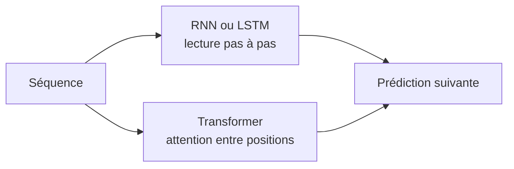
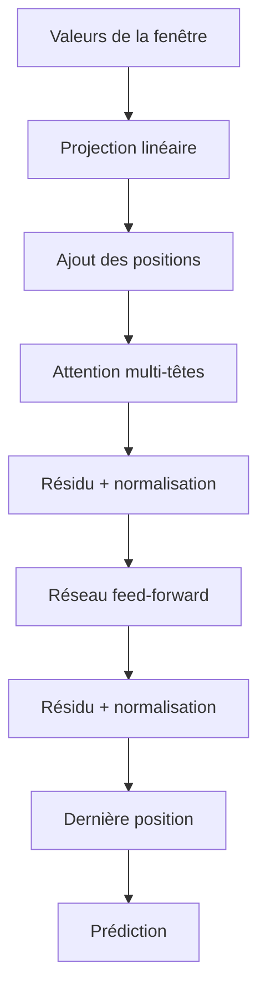
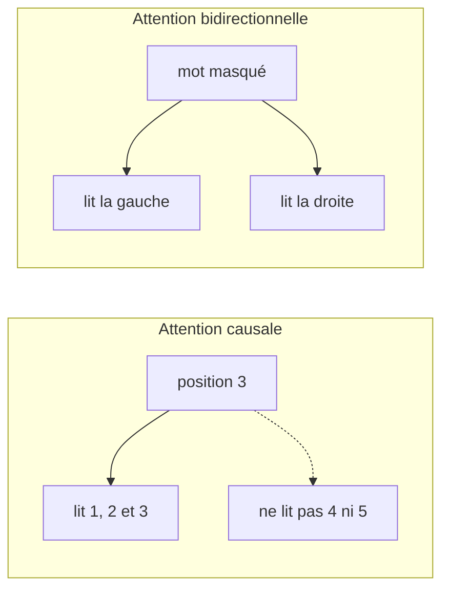

# Deep-Learning-Transformers

Projet académique sur les architectures de séquences, réalisé à partir du TP n°4
« Architecture Transformer » du professeur Mohamed Youssfi
(ENSET Mohammedia).

Les chiffres de ce document viennent des exécutions enregistrées dans
`outputs/metrics/` et dans les notebooks. Quand une expérience n'a pas été
faite, elle est appelée hypothèse.

## Sommaire

1. [Présentation et objectifs](#1-présentation-et-objectifs)
2. [Fichiers de référence et exercices](#2-fichiers-de-référence-et-exercices)
3. [Le deep learning appliqué aux séquences](#3-le-deep-learning-appliqué-aux-séquences)
4. [Le RNN et son état caché](#4-le-rnn-et-son-état-caché)
5. [Le LSTM, état caché et état de cellule](#5-le-lstm-état-caché-et-état-de-cellule)
6. [L'architecture Transformer](#6-larchitecture-transformer)
7. [Q, K, V et la self-attention](#7-q-k-v-et-la-self-attention)
8. [Multi-head, positions, résidus et LayerNorm](#8-multi-head-positions-résidus-et-layernorm)
9. [RNN, LSTM et Transformer](#9-rnn-lstm-et-transformer)
10. [GPT et BERT](#10-gpt-et-bert)
11. [Masque causal et attention bidirectionnelle](#11-masque-causal-et-attention-bidirectionnelle)
12. [Les notebooks et les exercices](#12-les-notebooks-et-les-exercices)
13. [Dimensions, exemples et équations](#13-dimensions-exemples-et-équations)
14. [Séries temporelles et fenêtres glissantes](#14-séries-temporelles-et-fenêtres-glissantes)
15. [Train, validation, test et fuite de données](#15-train-validation-test-et-fuite-de-données)
16. [MSE, MAE, RMSE et entropie croisée](#16-mse-mae-rmse-et-entropie-croisée)
17. [Hyperparamètres](#17-hyperparamètres)
18. [Lire les graphiques](#18-lire-les-graphiques)
19. [Comparaison expérimentale](#19-comparaison-expérimentale)
20. [Réponses aux questions](#20-réponses-aux-questions)
21. [Installation](#21-installation)
22. [Commandes Windows, Linux et macOS](#22-commandes-windows-linux-et-macos)
23. [Jupyter et les tests](#23-jupyter-et-les-tests)
24. [CPU, GPU et Hugging Face](#24-cpu-gpu-et-hugging-face)
25. [Dépannage](#25-dépannage)
26. [Limites, reproductibilité, améliorations](#26-limites-reproductibilité-améliorations)
27. [Dépôt et GitHub](#27-dépôt-et-github)

## Fil conducteur pour l'oral

1. Une séquence se lit avec un ordre. Ici, on prédit toujours la valeur suivante.
2. Le RNN comprime le passé dans un état caché de 16 nombres.
3. Le LSTM ajoute une mémoire de cellule et trois portes.
4. Le Transformer remplace cette récurrence par l'attention : requêtes, clés, valeurs.
5. Sur la sinusoïde, les trois modèles sont très précis. Le LSTM a la RMSE la plus basse de cette exécution.
6. Sur l'électricité, l'encodeur à 24 heures bat la persistance et la copie de la veille, en MAE et en RMSE, sur le test chronologique.
7. GPT regarde seulement le passé. BERT regarde les deux côtés d'un mot masqué.
8. Le mini-GPT et le mini-BERT sont entraînés ici depuis zéro. GPT-2 et BERT multilingue sont seulement interrogés.

---

## 1. Présentation et objectifs

Le projet fait passer des mêmes idées, des séries numériques jusqu'au texte.

| Partie | Question posée au modèle | Données |
|---|---|---|
| Sinusoïde | Quelle est la 11e valeur après 10 valeurs de sinus ? | 200 points calculés |
| RNN, LSTM, Transformer | La même question, trois architectures | 150 fenêtres d'entraînement, 40 de test |
| GPT-2 et BERT | Continuer un texte, ou remplir un masque | Modèles déjà entraînés |
| Exercice 1 | Quelle sera la puissance moyenne de l'heure suivante ? | Consommation UCI, agrégée par heure |
| Exercice 2 | Quel est le prochain caractère ? | `corpus.txt`, écrit pour le TP |
| Exercice 3 | Quel mot se cache derrière le masque ? | Petit corpus de phrases |

Les architectures, les dimensions et les hyperparamètres fixés par le sujet sont respectés.
Quand le sujet laisse un choix libre, le choix est indiqué dans la section 17.
Le code exécutable est dans `src/`. Les notebooks racontent les expériences et gardent leurs sorties.

## 2. Fichiers de référence et exercices

| Fichier | Rôle |
|---|---|
| `references/architecture_transformer.ipynb` | Notebook du cours : RNN, LSTM, Transformer, GPT-2, BERT, puis les trois exercices |
| `references/Architecture Transformers Pr YOUSSFI V2.pdf` | Support de 27 diapositives du même cours |
| `data/raw/individual+household+electric+power+consumption.zip` | Jeu UCI, non versionné |
| `corpus.txt` | Texte original du mini-GPT |

Le PDF est un support visuel. Les formules, les dimensions et les questions reprises ici viennent du notebook, qui contient à la fois le cours et le code.
Une différence de nom apparaît dans le cours : un paragraphe explique une classe `PetitRNN`, alors que la cellule exécutable définit `SimpleRNN`. Le projet suit la classe exécutable.

Le code BERT du notebook d'origine masque la phrase « Rabat est la [MASK] Maroc. ». Le texte explicatif du même notebook, et la consigne de ce projet, utilisent « Paris est la [MASK] de la France. ». Les deux phrases sont interrogées dans le notebook 02. Paris est la phrase principale.

La photo `references/IMG_7395 2.heic` reste sur la machine et n'entre pas dans Git : ce n'est pas un document du TP.

Les trois exercices demandés à la fin du notebook sont :

1. **EnergyTransformer** : 24 heures de puissance moyenne pour prédire l'heure suivante.
2. **Mini-GPT** : décodeur caractère, entraîné depuis zéro, avec un test de masque causal.
3. **Mini-BERT** : encodeur de mots masqués, avec un test de masque de padding. Il est traité en bonus, dans son propre notebook.

## 3. Le deep learning appliqué aux séquences

Un réseau de neurones apprend une fonction à partir d'exemples. Pour une image fixe, l'ordre des pixels peut être imposé par la grille. Pour une série ou une phrase, l'ordre fait partie du sens : la valeur de 8 h n'a pas le même rôle que la valeur de 20 h, et le mot qui suit dépend des mots déjà lus.

Trois façons de traiter cet ordre sont étudiées.



- Le RNN et le LSTM avancent dans le temps. Ils transportent un résumé.
- Le Transformer calcule, pour chaque position, un mélange des autres positions.
- Dans les deux cas, l'apprentissage compare la prédiction à la cible, puis corrige les poids.

La cible de ce projet est presque toujours « l'élément suivant » : la 11e valeur du sinus, l'heure électrique suivante, ou le caractère suivant. BERT change la question : un élément du milieu est caché, et le modèle le retrouve grâce au contexte des deux côtés.

## 4. Le RNN et son état caché

Un RNN réutilise **la même cellule** à chaque instant. Les cases dessinées dans le cours ne sont pas des couches différentes : ce sont les étapes temporelles d'une seule couche.

À l'instant `t`, la cellule reçoit la valeur `x_t` et l'état précédent `h_{t-1}`. PyTorch calcule, avec une tangente hyperbolique :

```text
h_t = tanh(W_ih x_t + W_hh h_{t-1} + b)
```

Les matrices `W_ih`, `W_hh` et le biais `b` sont les mêmes à 8 h et à 20 h. C'est ce partage qui permet de lire une séquence de longueur variable avec un nombre fixe de paramètres.

Dans `SimpleRNN` :

| Élément | Valeur | Rôle |
|---|---|---|
| `input_size` | 1 | Une seule mesure à chaque instant |
| `hidden_size` | 16 | L'état caché contient 16 nombres |
| `batch_first` | `True` | La forme est `(lot, temps, variables)` |
| Sortie | `Linear(16, 1)` | Le dernier état devient une prédiction |

Au début d'une séquence, PyTorch met l'état à zéro. Après les 10 lectures, `etats[:, -1, :]` est le résumé utilisé pour prédire. Les états intermédiaires sont calculés, puis laissés de côté pour cette tâche.

La limite apparaît quand la séquence s'allonge. Pour que le premier instant influence le dernier, le signal traverse beaucoup de multiplications pendant la rétropropagation dans le temps. Il peut devenir minuscule, ou au contraire exploser. Le réseau a alors du mal à utiliser une information lointaine. Ce n'est pas une règle absolue sur 10 pas : sur la sinusoïde, le RNN apprend déjà très bien.

## 5. Le LSTM, état caché et état de cellule

Le LSTM (*Long Short-Term Memory*) garde la lecture pas à pas et ajoute une mémoire interne, l'état de cellule `c_t`.

Il reçoit trois objets : `x_t`, `h_{t-1}` et `c_{t-1}`. Trois portes, à valeurs entre 0 et 1, règlent la circulation.

| Porte | Idée |
|---|---|
| Oubli `f_t` | Quelle part de l'ancienne cellule garder |
| Entrée `i_t` | Quelle part du nouveau candidat écrire |
| Sortie `o_t` | Quelle part de la cellule montrer dans `h_t` |

Le candidat `\tilde{c}_t` est une proposition de nouveau contenu. Les mises à jour résumées dans le cours sont :

```text
c_t = f_t ⊙ c_{t-1} + i_t ⊙ c̃_t
h_t = o_t ⊙ tanh(c_t)
```

Le symbole `⊙` est une multiplication composante par composante. `nn.LSTM` de PyTorch implémente ces portes avec des sigmoïdes et une tangente hyperbolique. `SimpleLSTM` demande `hidden_size=16` et `num_layers=1`. Les 16 nombres de `h_t` et les 16 nombres de `c_t` appartiennent à la même couche : ce ne sont pas deux couches empilées.

La prédiction utilise encore seulement le dernier état caché, puis `Linear(16, 1)`. Comme il y a quatre transformations internes (oubli, entrée, candidat, sortie), le LSTM a davantage de paramètres que le RNN : **1 233** contre **321** dans cette exécution.

Les portes ne garantissent pas qu'une dépendance très longue sera apprise. Elles donnent au modèle un moyen de laisser passer un signal sans le réécrire entièrement à chaque pas.

## 6. L'architecture Transformer

Le Transformer, introduit pour le texte puis repris partout où il y a des séquences, ne fait pas circuler un état d'un instant au suivant. Chaque position construit sa représentation en interrogeant les autres.

Le cours utilise ici un **encodeur**, suivi d'une couche linéaire. Il n'y a pas de décodeur dans la sinusoïde ni dans l'exercice électrique.



| Composant | Rôle dans le projet |
|---|---|
| Projection ou embedding | Passer d'une valeur, ou d'un token, à un vecteur |
| Positions | Rendre l'ordre visible, puisque l'attention seule ne le connaît pas |
| Self-attention | Mélanger les positions utiles |
| Feed-forward | Transformer chaque position séparément |
| Résidu et LayerNorm | Laisser passer le signal et stabiliser l'échelle |
| Couche finale | Ramener le vecteur à une valeur, ou à un score de vocabulaire |

Pour la sinusoïde, une seule couche d'encodeur suffit, avec `d_model=16`. Pour l'électricité, il y en a deux, avec `d_model=32`. Le mini-GPT n'utilise pas `TransformerEncoderLayer` : ses blocs sont écrits explicitement, avec le masque causal demandé.

Le coût de l'attention complète grandit comme le carré du nombre de positions, parce que chaque position est comparée à toutes les autres. Une fenêtre de 24 heures reste petite. Une fenêtre de 168 heures coûterait beaucoup plus cher. Cette comparaison de coût n'a pas été mesurée dans le projet.

## 7. Q, K, V et la self-attention

À partir de la représentation d'une position, le modèle fabrique trois vecteurs.

| Nom | Question qu'il porte |
|---|---|
| **Q**, query, requête | Que cherche cette position ? |
| **K**, key, clé | Que propose cette position pour être retrouvée ? |
| **V**, value, valeur | Quelle information faut-il mélanger si elle est retenue ? |

La formule du cours est :

```text
Attention(Q, K, V) = softmax(Q Kᵀ / √d_k) V
```

On peut la raconter en quatre temps.

1. Le produit `Q Kᵀ` donne un score de compatibilité entre chaque requête et chaque clé.
2. La division par `√d_k` évite que ces scores deviennent trop grands quand les vecteurs sont longs. `d_k` est la dimension d'une tête.
3. Le softmax transforme chaque ligne de scores en poids positifs qui somment à 1.
4. Ces poids font une moyenne des valeurs `V`. La sortie d'une position est donc un mélange des valeurs qu'elle a jugées pertinentes.

Dans la sinusoïde, `d_model=16` et `nhead=2`, donc chaque tête travaille sur `16 / 2 = 8` composantes. Dans l'électricité, `32 / 4 = 8` également. Dans les mini-modèles de texte, `64 / 4 = 16`.

Si une clé est interdite, son score est retiré avant le softmax. Dans PyTorch, un masque booléen vaut `True` là où la relation est **interdite**. Le mini-GPT construit ce masque avec `torch.triu(..., diagonal=1)`, exactement comme le TP.

## 8. Multi-head, positions, résidus et LayerNorm

### Plusieurs têtes

Une seule attention devrait choisir un type de relation. Plusieurs têtes refont le calcul dans des sous-espaces différents, en parallèle. L'une peut s'attacher au pas précédent, une autre à une forme plus large. Leurs sorties sont concaténées, puis une matrice les recombine. Rien ne force chaque tête à avoir une signification lisible : on observe le résultat global.

### Positions apprises

L'ensemble des valeurs `{0,2 ; 0,8 ; 0,3}` ne dit pas lequel est arrivé en premier si l'on retire l'ordre. Le projet ajoute un vecteur appris par position :

```text
représentation = projection(x_t) + embedding_position[t]
```

`nn.Embedding(10, 16)` sert la sinusoïde. `nn.Embedding(24, 32)` sert les heures. `nn.Embedding(64, 64)` sert les caractères du mini-GPT, et les 32 places du mini-BERT. Ce sont des positions **apprises**, pas la sinusoïde fixe du papier originel. Le cours demande des vecteurs appris.

### Résidu

```text
sortie = entrée + transformation(entrée)
```

Si la transformation n'a encore rien d'utile, elle peut rester proche de zéro et l'entrée continue. Cela aide à empiler des couches. Dans le mini-GPT, le résidu est écrit deux fois par bloc : après l'attention, puis après le MLP.

### LayerNorm

La normalisation par couche recentre et remet à l'échelle **les composantes d'un vecteur**, pour un exemple et une position. Ce n'est pas la normalisation du jeu de données. Elle a un gain et un biais appris.

Le cours place, dans l'encodeur de la sinusoïde, la normalisation après l'attention et après le feed-forward. C'est le réglage `norm_first=False` de PyTorch, utilisé par `MiniTransformer` et `EnergyTransformer`.

Le mini-GPT suit une autre consigne : LayerNorm **avant** l'attention, puis LayerNorm avant le MLP. C'est une pré-normalisation. Les deux choix coexistent dans le projet parce que les deux énoncés les demandent.

## 9. RNN, LSTM et Transformer

| | RNN | LSTM | Transformer encodeur |
|---|---|---|---|
| Mémoire | Un état `h_t` | `h_t` et une cellule `c_t` | Pas d'état transmis d'un pas à l'autre |
| Ordre | Imposé par la lecture | Imposé par la lecture | Ajouté par les positions |
| Calcul | Pas à pas | Pas à pas | Positions traitées ensemble |
| Paramètres sur la sinusoïde | 321 | 1 233 | 2 433 |
| Masque | Inutile pour cette tâche | Inutile pour cette tâche | Inutile tant que la cible n'est pas dans l'entrée |
| Limite connue | Dépendances longues | Plus de paramètres, sans garantie | Coût quadratique en la longueur |

Sur 10 pas de sinus, la limite théorique du RNN ne l'empêche pas d'apprendre. Le classement réel est dans la section 19. Il ne faut pas le déduire de la taille du modèle : le Transformer a le plus de paramètres et n'a pas la RMSE la plus basse sur cette exécution.

## 10. GPT et BERT

| | GPT | BERT |
|---|---|---|
| Partie du Transformer | Décodeur seul | Encodeur seul |
| Attention | Causale | Bidirectionnelle |
| Question | Quel token vient ensuite ? | Quel token manque au milieu ? |
| Dans ce projet | `gpt2` préentraîné, et un mini-GPT caractère | `bert-base-multilingual-cased` préentraîné, et un mini-BERT de mots |

GPT-2 et BERT multilingue **ne sont pas entraînés ici**. Leurs fichiers sont téléchargés, puis le code les interroge. Le mini-GPT et le mini-BERT, eux, partent de poids aléatoires et apprennent sur nos textes.

GPT-2 a surtout été entraîné en anglais. La phrase du TP est donc : `Artificial intelligence can help people`. La génération demande 50 nouveaux tokens, `do_sample=True`, `temperature=0.8`, `top_p=0.9`.

BERT multilingue cased distingue les majuscules et couvre le français. Le masque utilisé est celui du tokenizer, `[MASK]`, pas une chaîne inventée.

Un token n'est pas toujours un mot. GPT-2 et BERT découpent souvent les mots en sous-mots. Le mini-GPT descend encore plus bas : un token est un caractère. Le mini-BERT remonte au mot entier, après une découpe par espaces.

## 11. Masque causal et attention bidirectionnelle



Le masque causal du mini-GPT est un triangle supérieur :

```text
True  = relation interdite
False = relation autorisée
```

La diagonale reste autorisée : une position peut se lire elle-même. Tout ce qui est strictement à droite est interdit. Le test d'évaluation modifie un caractère futur et vérifie que les logits déjà passés ne bougent pas. Sur le modèle entraîné, l'écart maximal mesuré vaut **0**.

L'encodeur de la sinusoïde et celui de l'électricité n'ont pas ce masque. Les 10 valeurs, ou les 24 heures, sont déjà connues. La cible n'est jamais placée dans l'entrée.

Le mini-BERT n'a pas de masque causal non plus. Il a un masque de padding : les cases `[PAD]` qui complètent la phrase jusqu'à 32 tokens ne doivent pas servir de contexte. Le test change les identifiants écrits dans ces cases, garde le même masque, et vérifie que les logits des vrais tokens restent identiques. L'écart mesuré vaut aussi **0**.

## 12. Les notebooks et les exercices

| Notebook | Ce qu'il exécute |
|---|---|
| `notebooks/01_sinusoide_rnn_lstm_transformer.ipynb` | Données, RNN, LSTM, Transformer, tableau MSE / MAE / RMSE |
| `notebooks/02_gpt2_bert_pretrained.ipynb` | GPT-2 puis BERT, sans entraînement |
| `notebooks/03_energy_transformer.ipynb` | Exercice 1, données UCI, 20 époques, baselines, sept jours |
| `notebooks/04_mini_gpt.ipynb` | Exercice 2, trois températures, test causal |
| `notebooks/05_mini_bert_bonus.ipynb` | Exercice 3, exactitude, trois propositions, test de padding |

`scripts/verification_rapide.py` entraîne le RNN pendant 5 époques seulement. Il sert à vérifier que l'environnement répond. Les notebooks, eux, font les entraînements complets demandés.

`scripts/build_notebooks.py` peut réécrire les cinq notebooks. Il efface alors les sorties déjà calculées. Il ne faut pas le lancer si l'on veut garder les résultats.

## 13. Dimensions, exemples et équations

### Sinusoïde

`x` contient 200 valeurs entre 0 et 20. `y = sin(x)`.

| Tenseur | Forme |
|---|---|
| Série | `(200,)` |
| Toutes les fenêtres `X` | `(190, 10, 1)` |
| Cibles `y` | `(190, 1)` |
| Entraînement | `(150, 10, 1)` et `(150, 1)` |
| Test | `(40, 10, 1)` et `(40, 1)` |

La première fenêtre contient `s0 ... s9` et vise `s10`. La seconde contient `s1 ... s10` et vise `s11`.

```text
(B, 10, 1) --RNN ou LSTM--> (B, 10, 16) --dernier état--> (B, 16) --Linear--> (B, 1)
(B, 10, 1) --projection + positions--> (B, 10, 16) --encodeur--> (B, 10, 16) --dernière position--> (B, 1)
```

### Électricité

```text
(B, 24, 1) --Linear(1, 32) + positions--> (B, 24, 32) --2 encodeurs--> (B, 24, 32) --dernière heure--> (B, 1)
```

Le modèle compte **26 273** paramètres. Le retour aux kilowatts est :

```text
valeur_kW = valeur_normalisée × écart_type_train + moyenne_train
```

Sur cette exécution, la moyenne d'entraînement vaut **1,0865 kW** et l'écart-type **0,9287 kW**.

### Mini-GPT

| Tenseur | Forme |
|---|---|
| Identifiants | `(batch, 64)` |
| Représentations | `(batch, 64, 64)` |
| Logits | `(batch, 64, 70)` |
| Cibles | `(batch, 64)` |

Le vocabulaire mesuré de `corpus.txt` contient **70** caractères. Le modèle compte **113 094** paramètres.

Pour l'exemple pédagogique du cours, l'entrée `Bonjo` a pour cible `onjou` : chaque position apprend le caractère suivant, et le dernier caractère de la cible n'était pas dans l'entrée.

### Mini-BERT

Une phrase devient :

```text
[CLS] le chat dort sur le canapé [SEP] [PAD] ...
```

La forme est `(batch, 32)`. Les logits ont la forme `(batch, 32, 92)` avec le vocabulaire mesuré. Les étiquettes valent `-100` partout sauf aux positions tirées pour être prédites.

## 14. Séries temporelles et fenêtres glissantes

Une fenêtre glissante transforme une longue série en exemples supervisés.

```text
série : s0 s1 s2 s3 s4 s5 s6 s7 s8 s9 s10 s11
fenêtre 0 : [s0 ... s9]   -> s10
fenêtre 1 : [s1 ... s10]  -> s11
```

Les fenêtres voisines partagent des valeurs. Le cours le dit explicitement : ce recouvrement est normal. Ce qui ne doit pas se produire, c'est qu'une cible de test serve à régler les poids, ou qu'une statistique du test entre dans la normalisation.

Pour l'électricité, la série brute est minute par minute. `Global_active_power` est la puissance active globale du foyer, en kilowatts. Les `?` deviennent des manquants. Après la moyenne horaire, une heure de moins de 45 mesures numériques est mise à NaN. Toute fenêtre de 24 heures qui touche un NaN est supprimée.

L'évaluation électrique est horaire et **non autorégressive** : pour prédire l'heure `t`, le modèle reçoit les vraies mesures de `t-24` à `t-1`. On ne remplace pas ces mesures par des prédictions précédentes.

## 15. Train, validation, test et fuite de données

### Sinusoïde

Le découpage est un préfixe. Les 150 premières fenêtres entraînent. Les 40 dernières testent. Il n'y a pas de validation séparée dans le TP : les 300 époques sont toutes exécutées.

### Électricité

La coupure se fait sur l'index horaire, avant de jeter les NaN, comme dans le code du sujet :

```text
fin_train = int(0,70 × n)
fin_val   = int(0,85 × n)
```

Avec `n = 34 589` heures, cela donne les indices 24 212 et 29 400. Après suppression des fenêtres incomplètes, il reste **23 805** fenêtres d'entraînement, **5 054** de validation et **4 932** de test.

La série couvre du **16 décembre 2006, 17 h**, au **26 novembre 2010, 21 h**. Parmi les 34 589 heures du calendrier, **34 151** ont au moins 45 mesures.

| Lot | Règle |
|---|---|
| Train | La cible est strictement avant `fin_train` |
| Validation | La cible est dans `[fin_train, fin_val)` |
| Test | La cible est à partir de `fin_val` |

Une fenêtre de validation peut commencer dans les dernières heures du train. Ces heures sont du passé. Elles ont le droit de servir d'entrée. Elles n'ont pas le droit de servir de statistique calculée avec le test.

La moyenne et l'écart-type viennent de `serie.iloc[:fin_train]` seulement. Le test `test_normalization_does_not_use_the_future` change toute la fin de la série et vérifie que ces deux nombres restent les mêmes.

Le meilleur epoch électrique est choisi avec la validation. Le test n'intervient qu'ensuite, une fois le checkpoint retenu. Ici, c'est l'**époque 17**.

### Texte

Le mini-GPT construit l'alphabet sur tout `corpus.txt`, comme le code du sujet qui fait `sorted(set(texte))`. Les fenêtres d'entraînement, elles, viennent des **90 %** premiers caractères. Les 10 % suivants servent seulement à la perte de validation. Le modèle retenu est celui de la meilleure perte de validation, pas automatiquement le dernier epoch.

Le vocabulaire du mini-BERT est construit sur les phrases d'entraînement seules. Un test vérifie que chaque mot de validation existe déjà dans ce vocabulaire. Les phrases de validation sont d'autres combinaisons, pas une simple copie.

## 16. MSE, MAE, RMSE et entropie croisée

Pour une prédiction numérique `ŷ` et une cible `y` :

```text
MSE  = moyenne( (y - ŷ)² )
MAE  = moyenne( |y - ŷ| )
RMSE = racine(MSE)
```

La MSE pénalise fortement les grands écarts, parce qu'elle les élève au carré. La MAE reste dans l'unité de la cible : un écart de 0,3 kW compte 0,3. La RMSE revient aussi dans cette unité, tout en restant plus sensible aux pointes que la MAE.

Sur la sinusoïde, l'unité est celle du sinus, déjà entre -1 et 1. Sur l'électricité, les trois scores publiés sont calculés **après** retour en kilowatts. Une MSE basse sur les données normalisées ne se compare pas directement à la persistance.

Pour le texte, la perte est l'entropie croisée. Le modèle produit un score par caractère, ou par mot. Le softmax en fait des probabilités. La perte est faible quand la probabilité du bon token est grande. `CrossEntropyLoss(ignore_index=-100)` saute les positions marquées `-100`. Le mini-BERT s'en sert pour ne payer que les positions sélectionnées, y compris celles qui sont restées visibles parmi les 10 %.

L'exactitude du mini-BERT est le taux de positions sélectionnées où l'identifiant le plus probable est le mot d'origine. Avec 92 mots, répondre au hasard tourne autour de 1 %. Le nombre de positions change un peu d'un tirage de masques à l'autre : la mesure finale porte sur **61** positions.

## 17. Hyperparamètres

### Fixés par le sujet

| Expérience | Réglage |
|---|---|
| Graine de la sinusoïde | 42 |
| RNN et LSTM | `input_size=1`, `hidden_size=16`, Adam, pas 0,01, MSE, 300 époques |
| LSTM | `num_layers=1`, `batch_first=True` |
| Mini-Transformer | projection `1→16`, positions apprises, `d_model=16`, 2 têtes, feed-forward 32, dropout 0, 1 couche, 300 époques, pas 0,01 |
| GPT-2 | 50 nouveaux tokens, `do_sample=True`, température 0,8, `top_p` 0,9 |
| BERT | `bert-base-multilingual-cased`, 5 meilleures propositions |
| Électricité | projection `1→32`, 2 couches, 4 têtes, feed-forward 128, dropout 0,1, Adam 0,001, MSE, au plus 20 époques, lots de 64 |
| Mini-GPT | contexte 64, dimension 64, 2 blocs, 4 têtes, MLP `64→256→64`, GELU, masque causal |
| Mini-BERT | longueur 32, 15 % des mots ordinaires, corruption 80 / 10 / 10, dimension 64, 2 couches, 4 têtes, perte masquée |

### Choisis pour les parties que le sujet ne chiffre pas

| Choix | Valeur | Pourquoi |
|---|---|---|
| Pas du mini-GPT | 0,003 | Adam, valeur courante pour un petit modèle caractère. Le sujet ne fixe pas le pas. |
| Budget mini-GPT | 60 époques × 80 lots de 32 | Entraînement de l'ordre d'une minute sur le Mac utilisé, avec suivi de la validation |
| Pas du mini-BERT | 0,001 | Même famille qu'Adam sur l'exercice électrique |
| Budget mini-BERT | 30 époques, lots de 32 | Suffisant pour dépasser le hasard sur ce petit corpus |
| Largeur interne du mini-BERT | 256 | Le sujet ne la fixe pas. 256 reprend le facteur quatre du mini-GPT |
| Dropout du mini-BERT | 0,1 | Aligné sur l'encodeur électrique. Le mini-GPT reste à 0, comme aucun dropout n'est demandé |
| Sélection du checkpoint | Meilleure perte de validation | Demandée pour l'électricité, réutilisée pour les deux modèles de texte |

Le feed-forward de l'encodeur PyTorch utilise ReLU par défaut. C'est le réglage du mini-Transformer de la sinusoïde et de l'électricité, conformément au schéma du cours (`16 → 32 → 16` avec ReLU). Le mini-BERT utilise GELU, comme le mini-GPT et comme l'encodeur BERT habituel.

## 18. Lire les graphiques

Les fichiers sont dans `outputs/figures/`. Les notebooks les affichent aussi.

| Figure | Lecture |
|---|---|
| `01_sinusoide.png` | Deux cents points de sinus entre 0 et 20. La courbe est lisse et périodique. |
| `01_rnn_predictions.png`, `01_lstm_predictions.png`, `01_transformer_predictions.png` | En bleu, les 40 cibles de test. En rouge pointillé, les prédictions. Une courbe rouge collée au bleu veut dire une petite erreur. |
| `01_comparaison_courbes.png` | Les trois modèles sur le même test. |
| `01_comparaison_barres.png` | MAE et RMSE. La barre la plus basse est la meilleure. |
| `01_pertes.png` | MSE d'entraînement à chaque époque. Elle descend, puis se stabilise. |
| `03_energy_pertes.png` | MSE normalisée, train et validation. On cherche l'époque de validation la plus basse, pas forcément la dernière. |
| `03_energy_barres.png` | MAE et RMSE en kW. Le modèle est comparé à deux copies simples. |
| `03_energy_sept_jours.png` | Du 24 avril 2010 à 17 h au 1er mai 2010 à 16 h, soit 168 heures continues du test. |
| `04_minigpt_pertes.png` | L'entraînement continue de baisser alors que la validation remonte : le modèle finit par recopier le début du corpus. |
| `05_minibert_pertes.png` | Perte masquée. La validation est bruitée, parce que les masques sont retirés au hasard sur peu de phrases. |

Sur les sept jours électriques, les observations montrent des pointes, souvent le soir, et des nuits plus basses. La persistance suit la courbe avec un décalage d'une heure : elle répète ce qui vient de se passer, donc elle arrive en retard sur une montée brusque. L'EnergyTransformer suit le rythme jour-nuit et reste en moyenne plus proche, tout en lissant certaines pointes. Une RMSE plus basse ne veut pas dire que chaque pic est attrapé.

## 19. Comparaison expérimentale

Exécution du 19 novembre 2026, périphérique **MPS** (GPU Apple), graine 42. Un second passage sur un autre ordinateur peut bouger les décimales, surtout sur GPU.

### Sinusoïde, 40 fenêtres de test

| Modèle | MSE | MAE | RMSE |
|---|---:|---:|---:|
| RNN | 0,0000276 | 0,004562 | 0,005256 |
| LSTM | 0,00000250 | 0,001355 | 0,001582 |
| Transformer | 0,00000552 | 0,002041 | 0,002349 |

Les trois erreurs sont très petites devant l'amplitude du sinus. Sur **cette** exécution, le LSTM a la RMSE la plus basse, puis le Transformer, puis le RNN. Les pertes d'entraînement finales vont dans le même sens : 0,0000251 pour le RNN, 0,00000318 pour le LSTM, 0,00000434 pour le Transformer.

Ce classement ne se transporte pas tel quel à l'électricité. La sinusoïde est une fonction parfaite, sans bruit et sans changement d'habitude.

### Électricité, 4 932 heures de test, en kW

| Méthode | MSE | MAE | RMSE |
|---|---:|---:|---:|
| EnergyTransformer | 0,2365 | 0,3430 | 0,4863 |
| Persistance, heure `t-1` | 0,3462 | 0,3892 | 0,5884 |
| Veille, heure `t-24` | 0,5835 | 0,5133 | 0,7639 |

Le modèle améliore les deux références sur les deux métriques. L'écart de MAE avec la persistance est d'environ 0,046 kW. L'écart avec la veille est d'environ 0,170 kW. La moyenne d'entraînement étant proche de 1,09 kW, une MAE de 0,34 kW reste une erreur notable : le foyer n'est pas prédit au dixième de kilowatt près.

### GPT-2 et BERT, modèles seulement interrogés

Le notebook 02 a bien téléchargé les deux modèles. Aucun poids n'a été mis à jour.

La phrase anglaise est tokenisée en un tenseur `(1, 6)`. Avec la graine 42, 50 nouveaux tokens au maximum, température 0,8 et `top_p` 0,9, GPT-2 a produit :

> Artificial intelligence can help people understand and understand a vast range of things, from our everyday lives to the everyday activities of others, and from our work. For this reason, we think it's important to understand what is and isn't possible.

C'est une continuation plausible en anglais, pas une information vérifiée. La répétition « understand and understand » vient du tirage. Un autre tirage peut différer.

Pour « Paris est la [MASK] de la France. », BERT multilingue place en tête :

| Rang | Token | Probabilité |
|---|---|---:|
| 1 | capitale | 36,33 % |
| 2 | ville | 21,09 % |
| 3 | Cité | 3,16 % |
| 4 | préfecture | 1,67 % |
| 5 | banlieue | 1,64 % |

La phrase reconstituée la plus probable est « Paris est la capitale de la France. ».

La variante du code d'origine, « Rabat est la [MASK] Maroc. », est grammaticalement incomplète. Le modèle propose quand même « capitale » à 42,90 %, puis « du » à 20,66 %, « de » à 6,23 %, « ville » à 3,46 % et « Rabat » à 1,67 %. Ces probabilités décrivent le modèle, pas une correction de la phrase.

### Mini-GPT

| Indicateur | Valeur mesurée |
|---|---|
| Caractères du corpus | 13 400 |
| Vocabulaire | 70 |
| Tokens d'entraînement / validation | 12 060 / 1 340 |
| Meilleure perte de validation | 2,028 |
| Dernière époque, train / validation | 0,185 / 5,175 |
| Écart du test causal | 0 |

Une perte uniforme sur 70 caractères vaudrait environ `ln(70) ≈ 4,25`. Descendre à 2,03 montre que le modèle a appris des régularités. La chute finale de l'entraînement jusqu'à 0,185, pendant que la validation remonte à 5,175, montre qu'il mémorise ensuite le début du texte. La génération utilise l'époque de meilleure validation, pas la dernière.

Les 200 caractères produits, amorce comprise dans la chaîne affichée, sont dans la section 20.

### Mini-BERT

| Indicateur | Valeur mesurée |
|---|---|
| Phrases train / validation | 576 / 48 |
| Vocabulaire, tokens spéciaux compris | 92 |
| Paramètres | 113 884 |
| Exactitude finale sur la validation | 49,2 % |
| Positions comptées dans cette mesure | 61 |
| Perte associée | 1,525 |
| Écart du test de padding | 0 |

Cette exactitude de 49,2 % est recalculée après avoir rechargé le meilleur modèle, avec les masques de la graine 123. Elle ne se confond pas avec les pourcentages affichés époque par époque : chaque époque retire un autre ensemble de mots, et le jeu de validation est petit. Le hasard, lui, serait proche de 1 %.

Les quatre démonstrations de mots masqués portent sur des phrases **présentes dans l'entraînement**, répétées pour que le mécanisme soit visible :

| Phrase | Mot masqué | Top 3 mesuré |
|---|---|---|
| paris est la capitale de la france | capitale | capitale 64,7 %, ville 13,4 %, paris 3,0 % |
| le chat dort sur le canapé | dort | dort 58,1 %, reste 31,8 %, regarde 0,8 % |
| le chien dort sur le tapis | tapis | tapis 79,7 %, canapé 5,5 %, salon 3,1 % |
| la consommation augmente le soir | augmente | augmente 57,5 %, utilise 6,5 %, éclaire 4,1 % |

Le mot d'origine est chaque fois le premier. C'est une réussite de mémorisation sur des phrases vues, cohérente avec un petit corpus répété. L'exactitude de 49,2 % est l'indicateur à citer pour les phrases de validation.

## 20. Réponses aux questions

### Exercice 1

**Le Transformer améliore-t-il les deux références ?**

Oui, sur le test de cette exécution. La MAE passe de 0,389 kW (persistance) et 0,513 kW (veille) à 0,343 kW. La RMSE passe de 0,588 kW et 0,764 kW à 0,486 kW. Le graphique de sept jours montre aussi la limite de cette moyenne : certaines pointes restent sous-estimées, et la courbe prédite est plus lisse que les observations. Le gain est réel. Il n'est pas une prévision parfaite.

**Une fenêtre de 168 heures capturerait-elle mieux les habitudes hebdomadaires ?**

Hypothèse, non testée. Le rythme visible sur le graphique est d'abord journalier. Une habitude du type « le samedi ressemble au samedi précédent » tombe en dehors des 24 heures. Une fenêtre de 168 heures pourrait la voir. Elle augmenterait le coût de l'attention et demanderait un nouvel entraînement, avec le même soin contre la fuite. Le projet ne mesure pas ce gain.

**Quel serait l'intérêt d'ajouter l'heure et le jour ?**

Hypothèse, non testée. Les positions apprises distinguent « il y a une heure » de « il y a 23 heures ». Elles ne disent pas « il est 19 h » ni « c'est dimanche » de façon absolue, parce que la fenêtre peut commencer à n'importe quelle heure. Fournir l'heure de la journée et le jour de la semaine donnerait ce calendrier explicitement. Cela peut aider un foyer régulier. Cela peut aussi être inutile si la puissance contient déjà ce rythme. Seule une expérience avec ces variables trancherait.

**Pourquoi normaliser seulement avec l'entraînement ?**

Parce que la moyenne et l'écart-type sont des informations. Les calculer avec le test ferait entrer le futur dans le prétraitement. Au moment où l'on prévoit vraiment l'heure suivante, les heures de test n'existent pas encore. Le projet le vérifie : modifier la fin de la série ne change ni la moyenne ni l'écart-type utilisés. Le retour en kilowatts réemploie ces deux nombres de train, pour le modèle comme pour les deux références, afin que la comparaison reste honnête.

**Comment passer des kW aux kWh ?**

`Global_active_power` est une puissance. Pour une heure complète de 60 minutes, l'énergie en kWh est numériquement égale à la puissance moyenne en kW, car on multiplie par une durée d'une heure. `somme des puissances / 60` et la moyenne coïncident alors. Le filtre du sujet garde les heures dès 45 mesures. Pour ces heures incomplètes, multiplier la moyenne des minutes présentes par une heure **n'est plus** l'énergie réellement mesurée. Il faudrait additionner chaque minute observée comme un soixantième d'heure, sans combler les trous par la moyenne. Cette préparation n'a pas été réentraînée.

### Exercice 2

**Que se passe-t-il pendant l'entraînement si le masque causal est supprimé ?**

Le test mesuré montre d'abord le mécanisme inverse. Avec le masque, en mode évaluation, modifier le caractère de la position 20 laisse les logits des positions précédentes inchangés : l'écart maximal vaut 0. Sans masque, une position pourrait lire des caractères situés plus loin dans la même fenêtre, donc une partie de la réponse. La perte deviendrait trop facile. À la génération, ces caractères futurs n'existent pas encore. Le modèle serait alors utilisé autrement que pendant l'entraînement. Cet effet sur la qualité du texte n'a pas été mesuré par un second entraînement sans masque.

**Quel effet la température a-t-elle sur la génération ?**

Trois textes de 200 nouveaux caractères ont été tirés avec la même amorce et la même graine. L'amorce est : « Le transformeur lit une séquence et prédit le ».

Température 0,5. Le texte reste plus proche de syllabes déjà fréquentes et répète des petits mots :

> Le transformeur lit une séquence et prédit le coucué décite. Le de tour de la couche la déciple de l'avecter de de de la la sonne d'exerre dour de la donne le matin, pas le carache d'exe résuite la de connésit de le cormencure le suite la d'anson

Température 1,0. La distribution n'est pas modifiée. Le texte se disperse davantage :

> Le transformeur lit une séquence et prédit le à déjéqu'heure quédé nante. La ménédient la néparage. Le de sérofdemedi sées poin quis. La vansurenal. Da appuit minte, pau la caragendri. On mal. La soune tinge poyensuie, on nue posituat. Ilutencut

Température 1,5. La distribution est aplatie. Des caractères plus rares et des coupures plus brutales apparaissent, par exemple la capitale au milieu d'un mot :

> Le transformeur lit une séquence et prédit le à. On à le tirtexerd. Un jeune a cydïen. On iténe heure, de soublé médi séranne hore, . La vanlietuan. écorteule heure, quance lantehmali. On mahdad l'etremens hPour lempaie pôburqui. Lhs-orpuite ente

Aucun des trois textes n'est un français correct. Le corpus fait 13 400 caractères et le modèle surapprend le début. La température change la dispersion du tirage. Elle ne crée pas, à elle seule, une grammaire que le modèle n'a pas stabilisée.

**Pourquoi décaler les cibles d'une position ?**

Le modèle doit dire le caractère qui n'est pas encore donné. Si la cible était identique à l'entrée, la meilleure stratégie serait de recopier. Avec le décalage, l'entrée `Bonjo` a pour cible `onjou`. Dans les tenseurs, `y` commence un cran après `x` et finit un cran plus loin. La perte est ensuite calculée sur les 64 positions.

### Exercice 3

**Pourquoi BERT peut-il utiliser le contexte à droite du mot masqué ?**

La phrase est déjà écrite. Le trou est un mot caché, pas un mot futur à inventer. « de la france » aide à comprendre que le trou de « paris est la [MASK] de la france » parle d'un rôle de la ville. Un décodeur causal n'aurait pas le droit de lire cette fin. L'encodeur le peut, parce que son entraînement consiste à restaurer des tokens au milieu du contexte.

**Pourquoi calculer la perte seulement sur les positions sélectionnées ?**

Environ 15 % des mots ordinaires sont choisis. Les autres restent visibles et servent de contexte. Une perte sur toute la phrase récompenserait surtout la copie des mots déjà montrés. `ignore_index=-100` retire ces positions. Les 10 % de positions choisies mais laissées inchangées restent dans la perte : le modèle doit quand même les retrouver, même s'il les voit.

**Pourquoi ce modèle n'écrit-il pas un texte comme GPT ?**

Il n'a pas été entraîné à produire le token suivant sous un masque causal. Il propose une distribution à une case masquée, en ayant vu la gauche et la droite. Les trois propositions affichées sont une réponse à cette question ponctuelle. Enchaîner ces consultations pour rédiger un paragraphe demanderait une autre procédure, et le résultat ne serait pas celui d'un décodeur.

## 21. Installation

Le projet a été exécuté avec **Python 3.12.10**. Le Python 3.15 du système n'avait pas de version de PyTorch disponible au moment du travail. Python 3.12 est donc la version recommandée.

Les versions figées dans `requirements.txt` sont celles de l'exécution :

| Paquet | Version |
|---|---|
| torch | 2.15.0 |
| numpy | 2.5.5 |
| pandas | 3.1.1 |
| matplotlib | 3.11.2 |
| scikit-learn | 1.9.1 |
| transformers | 5.23.0 |
| jupyter | 1.1.1 |
| pytest | 9.2.0 |

Placez l'archive UCI dans `data/raw/` sous le nom :

```text
individual+household+electric+power+consumption.zip
```

Le premier lancement du notebook 03 la décompresse et écrit un cache horaire dans `data/processed/`. Ces deux dossiers sont ignorés par Git.

## 22. Commandes Windows, Linux et macOS

### macOS et Linux

```bash
python3.12 -m venv .venv
source .venv/bin/activate
python -m pip install --upgrade pip
pip install -r requirements.txt
python -m ipykernel install --sys-prefix --name dlt --display-name "Python DLT"
```

### Windows PowerShell

```powershell
py -3.12 -m venv .venv
.\.venv\Scripts\Activate.ps1
python -m pip install --upgrade pip
pip install -r requirements.txt
python -m ipykernel install --sys-prefix --name dlt --display-name "Python DLT"
```

Si `py -3.12` n'existe pas, installez Python 3.12 depuis [python.org](https://www.python.org/downloads/) en cochant « Add python.exe to PATH », puis rouvrez PowerShell.

Sous macOS, le paquet officiel peut s'appeler `python3.12` même quand `python3` pointe vers une autre version. Vérifiez avec `python3.12 --version`.

## 23. Jupyter et les tests

Depuis la racine du projet, avec l'environnement activé.

Vérification rapide, quelques secondes :

```bash
pytest
python scripts/verification_rapide.py
```

`pytest` contrôle les formes de la sinusoïde, l'ordre des fenêtres, le fait que la normalisation ignore le futur, le seuil de 45 mesures, le masque causal, le décalage des cibles, le masque de padding, et le rechargement d'un checkpoint. Il lit aussi l'en-tête réel de l'archive UCI, sans agréger tout le fichier.

Entraînements complets : ouvrez les notebooks dans l'ordre et exécutez toutes les cellules avec le noyau **Python DLT**.

```bash
jupyter notebook
```

Les notebooks `01`, `03`, `04` et `05` ont déjà été exécutés dans ce dépôt : leurs sorties et les fichiers `outputs/` correspondent à cette exécution. Les relancer recalcule les résultats. Sur MPS ou CUDA, les décimales peuvent légèrement changer.

## 24. CPU, GPU et Hugging Face

`get_device()` choisit CUDA s'il existe, sinon MPS sur les Mac Apple Silicon, sinon le CPU. L'exécution enregistrée ici a utilisé **MPS**.

Forcer un périphérique :

```bash
# macOS ou Linux
export DLT_DEVICE=cpu

# Windows PowerShell
$env:DLT_DEVICE = "cpu"
```

Les valeurs acceptées sont `auto`, `cpu`, `cuda` et `mps`.

Les notebooks 01, 03, 04 et 05 n'ont pas besoin d'Internet. Le notebook 02 télécharge `gpt2` et `bert-base-multilingual-cased`. Le cache est dirigé vers `outputs/huggingface/`, qui n'est pas versionné. Comptez plusieurs centaines de mégaoctets et un délai au premier lancement. Les lancements suivants réutilisent le cache.

Si le téléchargement échoue, le notebook écrit l'erreur dans `outputs/metrics/02_modeles_preentraines.json` et n'invente ni texte ni probabilités.

## 25. Dépannage

| Symptôme | Piste |
|---|---|
| `No module named torch` | L'environnement `.venv` n'est pas activé, ou le notebook n'utilise pas le noyau Python DLT. |
| PyTorch ne s'installe pas | La version de Python est trop récente. Utilisez Python 3.12. |
| `FileNotFoundError` sur la consommation | Le zip n'est pas dans `data/raw/` avec le nom attendu. |
| `CUDA n'est pas disponible` | `DLT_DEVICE=cuda` a été forcé sur une machine sans NVIDIA. Retirez la variable, ou mettez `cpu`. |
| Jupyter ne voit pas le noyau | Relancez `python -m ipykernel install --sys-prefix --name dlt --display-name "Python DLT"` dans le `.venv`. |
| Erreur Hugging Face, réseau ou certificat | Vérifiez la connexion. Le reste du projet fonctionne sans ce notebook. |
| Les chiffres changent un peu | Normal sur GPU. Pour un contrôle plus stable : `DLT_DEVICE=cpu` et graine 42. Les tests unitaires ne dépendent pas de ce bruit. |
| `build_notebooks.py` a effacé les sorties | Les métriques JSON et les figures dans `outputs/` restent la trace de l'exécution, tant qu'elles n'ont pas été régénérées. |
| Perte de validation du mini-GPT très haute à la fin | C'est le surapprentissage mesuré. Le texte généré vient de la meilleure époque de validation, pas de la dernière. |

## 26. Limites, reproductibilité et améliorations

Limites déjà visibles dans les résultats.

- La sinusoïde est trop régulière pour départager des architectures destinées à des séquences difficiles. Tout le monde réussit.
- L'électricité est une seule maison, de fin 2006 à fin 2010. Le gain sur la persistance est modéré, et les pointes ne sont pas toutes suivies.
- Le mini-GPT surapprend un corpus de quelques pages. Ses textes montrent l'effet de la température, pas une maîtrise du français.
- Le mini-BERT réussit très bien les phrases répétées à l'entraînement. Son 49,2 % de validation est le chiffre à ne pas confondre avec les 60 à 80 % des démonstrations.
- GPT-2 et BERT ne prouvent rien sur notre entraînement : ce sont des modèles déjà appris ailleurs.
- MPS n'est pas parfaitement déterministe. La graine 42 fixe le point de départ, pas chaque arrondi du GPU.

Améliorations possibles, non testées.

- Ajouter l'heure et le jour dans l'EnergyTransformer, puis refaire le tableau de test.
- Comparer une fenêtre de 168 heures, avec le même protocole anti-fuite.
- Ajouter un dropout au mini-GPT, ou arrêter plus tôt, pour réduire l'écart entre perte d'entraînement et perte de validation.
- Agrandir le corpus de caractères avant de juger la qualité littéraire.
- Évaluer le mini-BERT sur davantage de phrases, et séparer l'exactitude des mots outils de celle des noms.

La reproductibilité du code repose sur la graine, le découpage chronologique, les tests, et les fichiers JSON. Relancer les notebooks est la façon de vérifier. Recopier les tableaux de ce README sans les recalculer les figerait à cette machine et à cette date.

## 27. Dépôt et GitHub

```text
Deep-Learning-Transformers/
├── README.md
├── requirements.txt
├── pytest.ini
├── .gitignore
├── corpus.txt
├── notebooks/
│   ├── 01_sinusoide_rnn_lstm_transformer.ipynb
│   ├── 02_gpt2_bert_pretrained.ipynb
│   ├── 03_energy_transformer.ipynb
│   ├── 04_mini_gpt.ipynb
│   └── 05_mini_bert_bonus.ipynb
├── src/
│   ├── data.py
│   ├── models.py
│   ├── training.py
│   ├── evaluation.py
│   └── text_models.py
├── tests/
├── scripts/
│   └── verification_rapide.py
├── data/
│   ├── raw/          # zip UCI, ignoré
│   └── processed/    # cache horaire, ignoré
├── outputs/
│   ├── figures/
│   ├── metrics/
│   ├── checkpoints/  # poids, ignorés
│   └── huggingface/  # modèles téléchargés, ignorés
└── references/
    ├── architecture_transformer.ipynb
    └── Architecture Transformers Pr YOUSSFI V2.pdf
```

Git ignore le jeu de données, les checkpoints, le cache Hugging Face, `.venv`, les fichiers `.env` et la photo HEIC. Il conserve le code, les notebooks, les tests, le README, les petites figures et les métriques JSON.

Le dépôt visé s'appelle `Deep-Learning-Transformers`, sous le compte GitHub `salmahmid`.

Création manuelle si la connexion `gh` n'est pas disponible :

```bash
git init -b main
git config --local user.name "salmahmid"
git config --local user.email "salmahmid2023@gmail.com"
git add .
git status
git commit -m "Version initiale du projet Architecture Transformer."
gh auth login
gh repo create Deep-Learning-Transformers --public --source=. --remote=origin --push
```

Avant le commit, `git status` doit montrer l'absence du zip, du fichier `household_power_consumption.txt`, du dossier `.venv` et des checkpoints `.pt`.

La section finale du travail, dans la réponse qui accompagne le dépôt, indique si le push a réellement abouti. Ce README ne le suppose pas.
